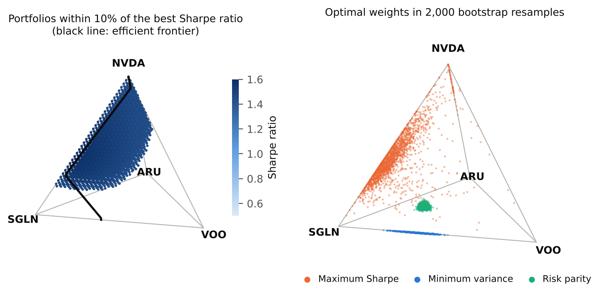
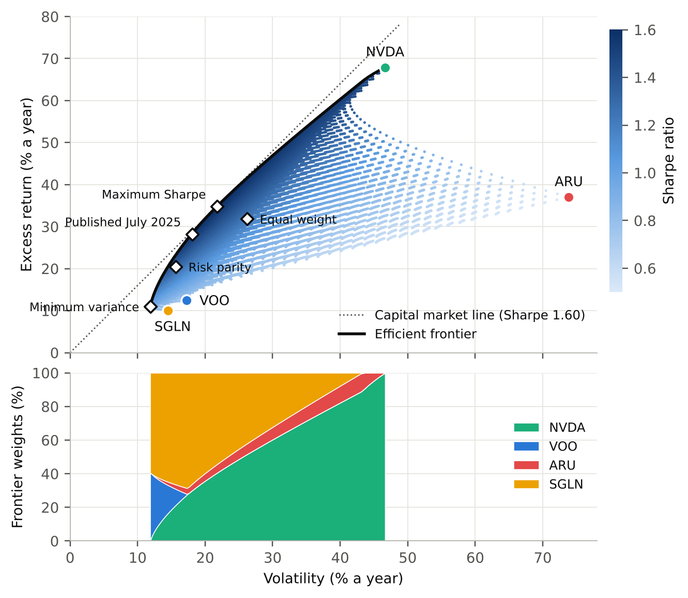
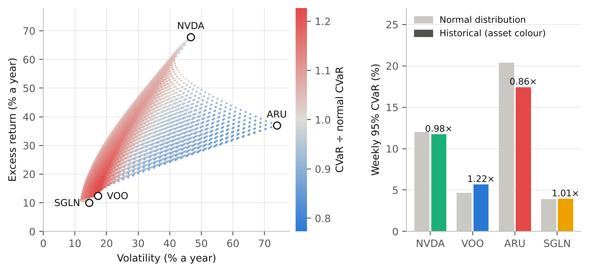
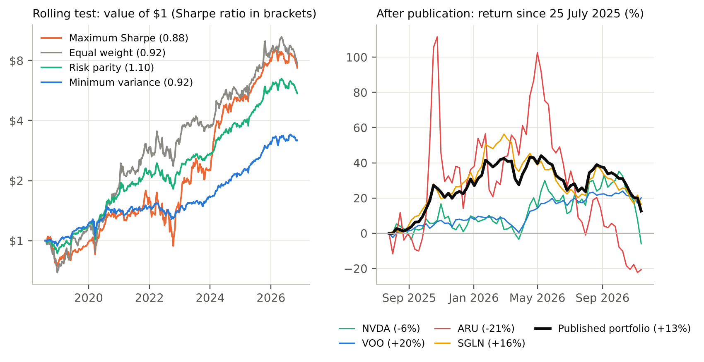

# A Four-Asset Efficient Frontier in Three Dimensions

**Estimation Error and an Out-of-Sample Test**
Mael Tok (McGill University). First version July 2025; this version November 2026.

🌐 **Interactive figures:** <https://2008mt.github.io/efficient-frontier-3d/>
📄 **Note:** [`TOK_EFFICIENT_FRONTIER_3D.pdf`](TOK_EFFICIENT_FRONTIER_3D.pdf)

[](https://2008mt.github.io/efficient-frontier-3d/)

## Summary

In July 2025 I optimised a portfolio of four assets (Nvidia, an S&P 500 fund, the rare-earth developer
Arafura, and gold) and published the mix with the highest Sharpe ratio. This version redoes that
exercise with the measurement fixed, then tests it on data the optimiser never saw.

- **In sample, the answer is still a barbell.** On weekly US-dollar returns from 2015 to 2025 the best
  long-only portfolio is 40% Nvidia, 54% gold, 5% Arafura and no S&P 500, with a Sharpe ratio of 1.60.
- **The optimum is flat.** 19% of all portfolios have a Sharpe ratio within 10% of the best. Among
  those within 5%, the Nvidia weight ranges from 25% to 75%.
- **It does not hold up out of sample.** Re-estimated every four weeks on the previous three years, the
  maximum-Sharpe rule expected a Sharpe ratio of 1.53 and earned 0.88, with a 47% drawdown. Equal
  weights earned 0.92 and risk parity 1.10.
- **The weights are mostly noise.** In 2,000 bootstrap resamples the optimal Nvidia weight has a 90%
  interval of 21% to 71%. Risk-parity weights barely move.
- **The published portfolio since publication.** From August 2025 to November 2026 it returned 12.6%
  with a Sharpe ratio of 0.36, against 1.56 in sample. The S&P 500 fund, which it excluded, returned
  20.1%. The comparison depends on the end date (see below); the misjudged risk does not.
- **Volatility is not the whole of risk.** The S&P 500 fund's worst weeks are 1.22 times as bad as a
  normal distribution implies; Arafura's are 0.86 times, because its large moves are upward jumps.

## What changed since the first version

Rereading the first version (July 2025, in this repository's commit history) a year later, I found four problems.

| Problem in the first version | Fix |
|---|---|
| Returns in three currencies (USD, AUD, GBP) combined as if one investor could earn them all | Everything converted to US dollars |
| Daily returns from markets that close up to 15 hours apart, which pushes correlations towards zero | Weekly returns, Friday to Friday |
| The main 3D plot used volatility, return and the Sharpe ratio as axes. The third is the second divided by the first, so the plot was a 2D picture drawn in 3D | The weights themselves are the three dimensions (a tetrahedron), and a separate plot adds tail risk |
| The portfolio was chosen and judged on the same ten years | Rolling out-of-sample test, a hold-out period, and a bootstrap |

The measurement fixes matter. The correlation between the S&P 500 fund and Arafura is 0.07 on the
first version's daily local-currency data and 0.25 on weekly dollar data; between the S&P 500 fund and
gold it goes from −0.11 to 0.14.

## Results

### The assets (31 July 2015 to 25 July 2025, 522 weeks)

| | Excess return | Compound growth | Volatility | Sharpe | Skewness | CVaR ÷ normal |
|---|---:|---:|---:|---:|---:|---:|
| **NVDA** | 67.9% | 80.2% | 46.6% | 1.46 | 0.32 | 0.98 |
| **VOO** | 12.5% | 13.8% | 17.3% | 0.72 | −0.64 | 1.22 |
| **ARU** | 37.0% | 14.6% | 73.9% | 0.50 | 1.30 | 0.86 |
| **SGLN** | 10.0% | 11.6% | 14.5% | 0.69 | 0.24 | 1.01 |

Excess return is the annualised arithmetic mean over Treasury bills, which is what the optimiser uses.
Compound growth is what a dollar actually earned. For Arafura the two are far apart: an average return
of 39% a year, but 14.6% compound growth, because at 74% volatility the losses compound harder than
the gains.

### The frontier



| Portfolio | NVDA | VOO | ARU | SGLN | Excess return | Volatility | Sharpe |
|---|---:|---:|---:|---:|---:|---:|---:|
| Maximum Sharpe | 40.5% | 0.0% | 5.1% | 54.5% | 34.8% | 21.7% | 1.60 |
| Published July 2025 | 28.6% | 0.0% | 6.1% | 65.3% | 28.2% | 18.1% | 1.56 |
| Equal weight | 25.0% | 25.0% | 25.0% | 25.0% | 31.9% | 26.2% | 1.21 |
| Risk parity | 12.6% | 30.4% | 8.9% | 48.1% | 20.5% | 15.7% | 1.31 |
| Minimum variance | 0.0% | 39.8% | 0.0% | 60.2% | 11.0% | 11.9% | 0.93 |

The frontier is solved exactly by quadratic programming, and checked against a lattice of 12,341
portfolios.

### Tail risk



For each portfolio I compare the average loss in its worst 5% of weeks (CVaR) with what a normal
distribution of the same volatility implies. 65% of portfolios have a fatter left tail than the normal
benchmark. Minimising CVaR instead of variance changes the frontier weights by at most 14 percentage
points and lowers CVaR by 1.7% on average, so here it refines the answer but does not change it.
The asymmetry in Arafura matches what I found on daily data in a
[separate paper](https://github.com/2008MT/aru-garch-var).

### Out of sample



**Rolling test, 27 July 2018 to 13 November 2026** (434 weeks, 109 rebalances, no costs):

| Rule | Sharpe | 90% interval | Compound growth | Volatility | Worst drawdown | Turnover a year |
|---|---:|:---:|---:|---:|---:|---:|
| Maximum Sharpe | 0.88 | 0.30 to 1.50 | 27.0% | 28.8% | −47% | 93% |
| Equal weight | 0.92 | 0.36 to 1.47 | 27.7% | 28.0% | −33% | 49% |
| Risk parity | 1.10 | 0.54 to 1.67 | 22.6% | 17.5% | −26% | 33% |
| Minimum variance | 0.92 | 0.40 to 1.47 | 14.9% | 13.1% | −18% | 20% |

The ranking among the rules is not statistically reliable; the intervals overlap almost entirely. What
the test shows is that optimising on estimated returns bought more turnover and a deeper drawdown and
no measurable gain.

**Hold-out, 1 August 2025 to 13 November 2026** (68 weeks, weights fixed in July 2025):

| | Sharpe to July 2025 | Total return | Volatility | Sharpe | Worst drawdown |
|---|---:|---:|---:|---:|---:|
| Published July 2025 | 1.56 | 12.6% | 21.1% | 0.36 | −22% |
| Equal weight | 1.21 | 15.9% | 27.4% | 0.41 | −26% |
| Risk parity | 1.31 | 18.3% | 18.5% | 0.58 | −17% |
| Minimum variance | 0.93 | 19.1% | 15.4% | 0.70 | −12% |
| NVDA | 1.46 | −5.9% | 33.7% | −0.08 | −30% |
| VOO | 0.72 | 20.1% | 12.0% | 0.92 | −8% |
| ARU | 0.50 | −20.7% | 78.6% | 0.11 | −63% |
| SGLN | 0.69 | 16.4% | 22.4% | 0.46 | −26% |

Sixty-eight weeks is too short to settle anything, and the verdict depends on the end date: the
published portfolio was ahead of the S&P 500 fund at 41 of the 43 possible end dates since January
2026, was up 44% at its peak in May 2026, and fell behind only in the last two weeks. What does not
depend on the end date is that its risk was misjudged. Gold, the defensive half of the barbell, had a
volatility of 22% in the hold-out against 14% before.

### Estimation error

| 90% bootstrap interval | NVDA | VOO | ARU | SGLN |
|---|:---:|:---:|:---:|:---:|
| Maximum Sharpe | 21% to 71% | 0% to 15% | 0% to 16% | 17% to 73% |
| Minimum variance | 0% to 0% | 32% to 48% | 0% to 0% | 52% to 68% |
| Risk parity | 11% to 14% | 28% to 33% | 8% to 10% | 46% to 51% |

The maximum-Sharpe weights are 4.6 times as dispersed as the minimum-variance weights. One result is
stable: the S&P 500 fund gets less than 1% in 89% of resamples. But a bootstrap can only reshuffle the
decade it is given, a decade in which Nvidia compounded at 80% a year. It measures sampling noise, not
the chance that the next decade is different.

## Limitations

- **The assets were chosen with hindsight.** I picked Nvidia in 2025 knowing how it had done. No test
  inside these four assets removes that.
- **Closing times still differ.** Weekly returns overlap by about 90%, not fully.
- **No trading costs.** Arafura trades on a coarse price grid, so the high-turnover rule would cost
  more than the others.
- **Thin tails.** A 5% tail of 522 weeks is 26 observations.
- **Long only, four assets, one decade.**

## Repository layout

```
TOK_EFFICIENT_FRONTIER_3D.pdf      the note
index.html, plots/                 the website (served by GitHub Pages)
main.tex, numbers.tex, tables/     LaTeX source of the note
code/                              Python code that produces every number, table and figure
results/                           output of the code (JSON and CSV)
figures/                           static figures
data/                              data description (prices are downloaded, not stored)
```

## Reproducing the results

Requires Python 3 (`pip install -r requirements.txt`) and, for the note, a LaTeX installation.
Run from `code/`:

| Step | Command | Output |
|---|---|---|
| 1 | `python fetch_data.py` | prices and exchange rates from Yahoo Finance, fixed dates |
| 2 | `python part1_frontier.py` | asset statistics, correlations, exact frontier, reference portfolios, CVaR |
| 3 | `python part2_out_of_sample.py` | rolling test and hold-out |
| 4 | `python part3_bootstrap.py` | bootstrap of the optimal weights (~1 min) |
| 5 | `python tables.py` | LaTeX tables and every number quoted in the note (`numbers.tex`) |
| 6 | `python figures.py` | static figures |
| 7 | `python plots.py` | interactive figures (`plots/`) |
| 8 | `python build_site.py` | `index.html` |

Then compile: `pdflatex main && pdflatex main`.

Yahoo recomputes adjusted prices over time, so a later download can differ from the results stored
here (downloaded 15 November 2026) in the last decimals. See [`data/README.md`](data/README.md).

## About

I built the first version in July 2025, in the summer before my final year of high school, and revised
it in November 2026 as a first-year student at McGill University. AI tools assisted with the first
version. Claude (Anthropic) was used in the November 2026 update, including the out-of-sample backtest
on data from July 2025 to November 2026. This is a study of method, not investment advice.
